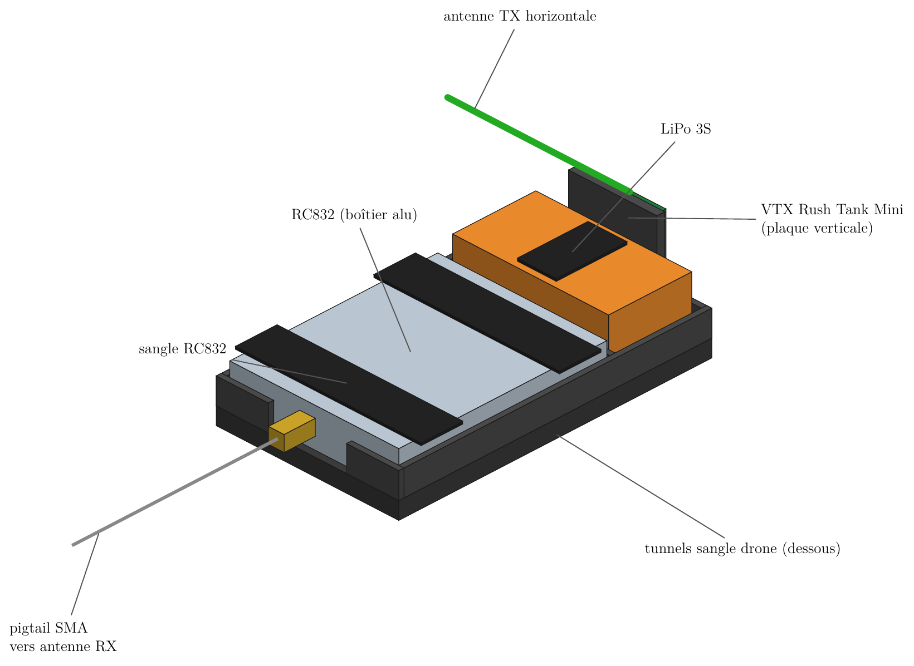
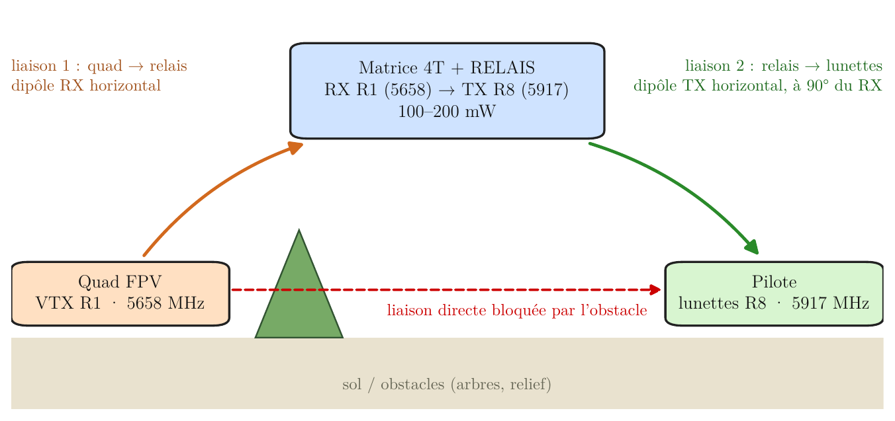
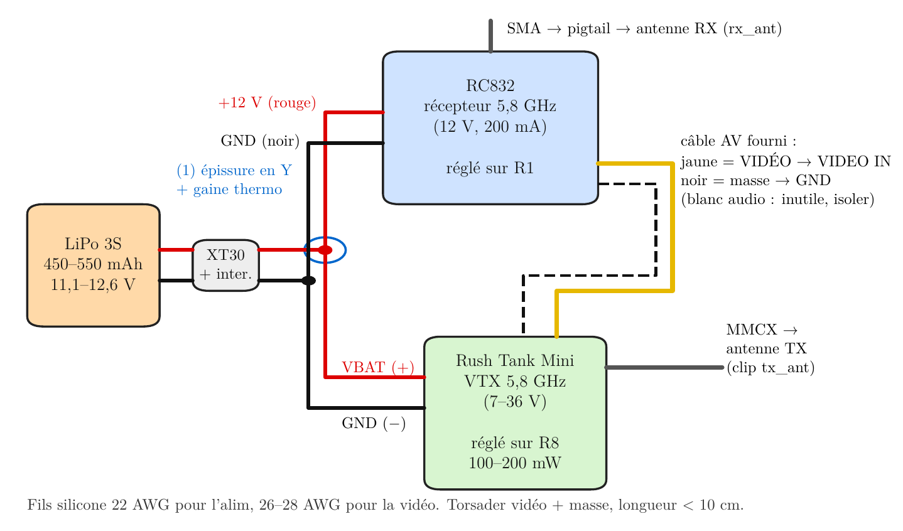
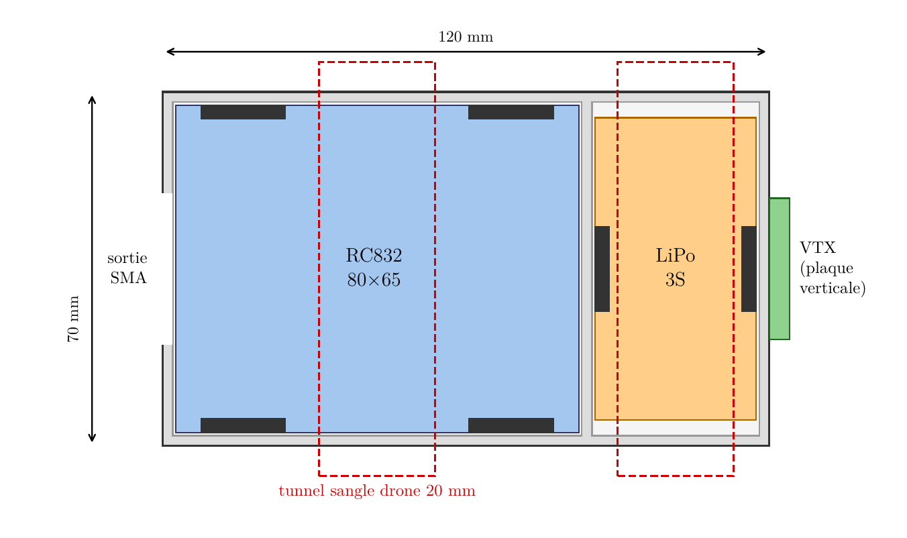
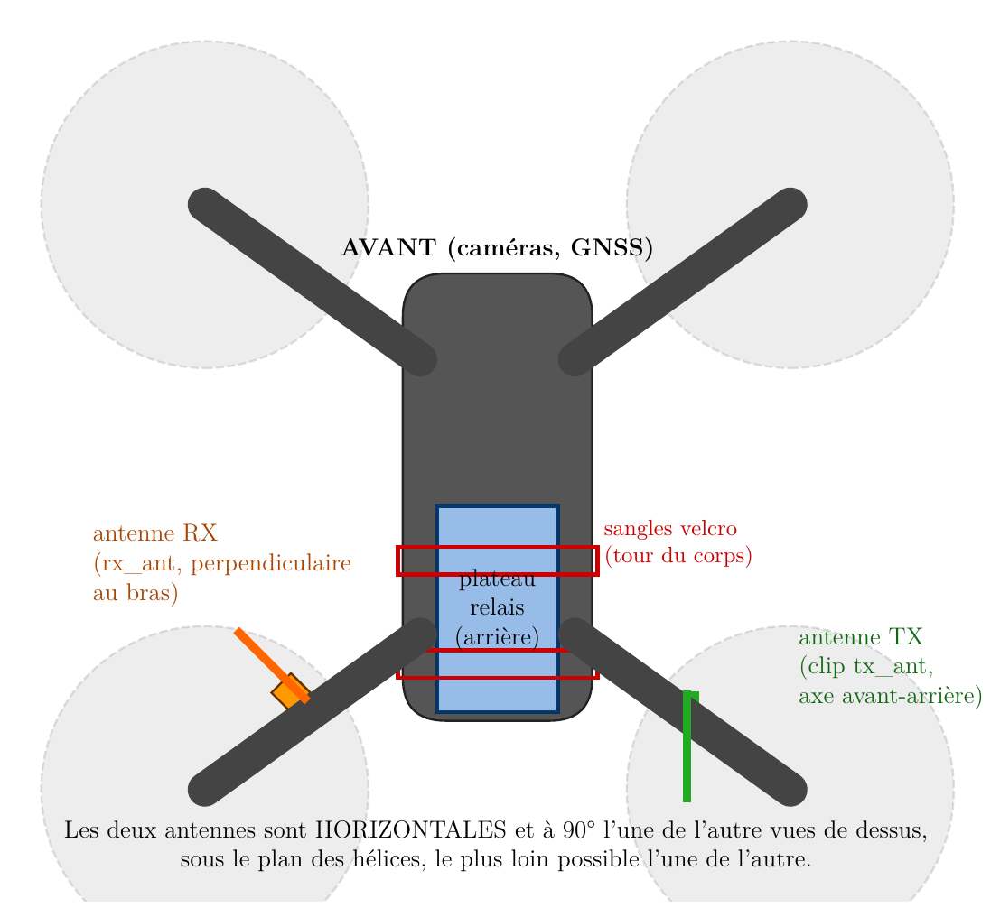

# Relais vidéo FPV 5,8 GHz embarqué sur DJI Matrice 4T

Relais vidéo analogique **5,8 GHz → 5,8 GHz** : il reçoit l'image du quad FPV sur **R1 (5658 MHz)** et la réémet vers les lunettes sur **R8 (5917 MHz)**, depuis un DJI Matrice 4T en altitude.

📄 **Note technique complète : [Relais_FPV_5.8GHz.pdf](Relais_FPV_5.8GHz.pdf)**

---

## 1. Principe

## 2. Schéma de câblage et soudure

| Liaison | Départ | Arrivée |
|---|---|---|
| Alimentation | LiPo 3S (XT30) + | RC832 +12 V et VTX VBAT |
| Masse | LiPo 3S – | RC832 GND et VTX GND |
| Vidéo | RC832 sortie AV (jaune) | VTX VIDEO IN |
| Masse vidéo | RC832 AV (noir) | VTX GND |

## 3. Plateau imprimé en 3D (vue de dessus)

## 4. Implantation sur le Matrice 4T

Les deux antennes sont **horizontales**, **croisées à 90°** vues de dessus, sous le plan des hélices et le plus loin possible l'une de l'autre.

## 5. Réglages

| Équipement | Réglage |
|---|---|
| VTX du quad | R1 – 5658 MHz |
| Récepteur du relais (RC832) | R1 |
| VTX du relais (Rush Tank Mini) | R8 – 5917 MHz, 100–200 mW |
| Lunettes | R8 |
| Liaison DJI | forcée en 2,4 GHz |
